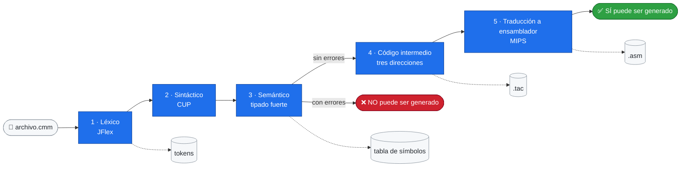

<div align="center">

#  Compilador `.cmm`
### Traducción de intermedio a ensamblador MIPS

**Instituto Tecnológico de Costa Rica** · Compiladores e Intérpretes (IC-5701) · II Semestre 2026


| Estudiante | Carné |
| :-- | :--: |
| Heldyis Agüero Espinoza | 2023296812 |
| Alice Arias Salazar | 2023104639 |

**Profesor:** Allan Rodriguez Davila · **Proyecto #3** · **Entrega:** 5 de diciembre de 2026

</div>

---

## ¿Qué hace?

Recibe un programa `.cmm`, lo analiza en **cinco fases** y dice si el archivo **SÍ** o **NO** puede ser generado por la gramática. Los errores no detienen el análisis: se reportan todos, con su línea y columna.



---

## Estado

- [X] Análisis léxico y sintáctico del Proyecto #1, corregidos
- [X] Análisis semántico con **tipado explícito y fuerte** (52 reglas)
- [X] Tabla de símbolos con **ámbitos anidados**, en consola y en archivo
- [X] Recuperación en **modo pánico**, **a nivel de frase**, **producción de errores** y **corrección global**
- [X] Código intermedio completo: operaciones, asignaciones, `read`/`write`, `++`/`--`, `if`/`elif`/`else`, `while`, `for`, `break`, funciones y arreglos
- [X] Traducción del código intermedio a ensamblador MIPS

---

## Compilar y ejecutar

> [!IMPORTANT]
> Se necesita **Java JDK 21** (mínimo 11). JFlex y Java CUP ya vienen en `Programa/librerias`.

```powershell
cd .\Programa
.\build.bat      # genera el parser y el lexer, y compila todo
.\run.bat        # muestra las pruebas y pide el nombre del archivo
```

Si el programa no tiene errores, `run.bat` también genera su código intermedio y su ensamblador MIPS en `salida/`.

O directamente, sin `run.bat`:

```powershell
java -cp "bin;librerias\java-cup-11b.jar" Main pruebas\correctas\pruebasX.cmm
```

> [!TIP]
> Usen una terminal **ancha** (unos 170 caracteres) para ver completas las tablas de errores y de símbolos.

> [!NOTE]
> Cada vez que cambie `Parser.cup`, `Lexer.flex` o un `.java`, hay que volver a ejecutar `build.bat`. Si se agrega un `.java` nuevo en `src/`, también se agrega a la lista del `javac` en `build.bat`.

---

## Estructura

```text
Programa/
├── build.bat · run.bat
├── gramatica/      Lexer.flex · Parser.cup
├── src/            Main · Atrib · Generador · TablaSimbolos · Simbolo
│                   Ambito · ReporteTablaSimbolos · CuadroTexto · fase5_mips/
├── librerias/      java-cup-11b.jar · jflex-full-1.9.1.jar
├── pruebas/        correctas/ · con_errores/
├── salida/         tokens/ · tabla_simbolos/ · codigo_intermedio/ · mips/
└── bin/            lo genera build.bat
```

| Archivo                                  | Responsabilidad                                                                             |
| :--------------------------------------- | :------------------------------------------------------------------------------------------ |
| `Parser.cup`                           | Gramática, **reglas semánticas** y llamadas al generador (decide **cuándo**) |
| `Generador.java`                       | Formato del código intermedio, temporales y etiquetas (decide **cómo**)             |
| `TablaSimbolos.java` y compañía      | **Guarda y busca** nombres por ámbito; no decide qué es un error                    |
| `GeneradorMIPS.java` y `fase5_mips/` | Traduce el TAC a MIPS y organiza datos, marcos de función y ubicaciones                    |
| `Main.java`                            | Coordina las fases, muestra los resultados y hace la corrección global                     |

---

## El lenguaje

|    Símbolo    | Significado              |  |       Símbolo       | Significado            |
| :-------------: | :----------------------- | :-: | :------------------: | :--------------------- |
| `¿:` `:?` | Bloque                   |  |        `»`        | Fin de sentencia       |
| `є:` `:э` | Paréntesis              |  |        `Ͱ`        | Asignación            |
| `ʃ:` `:ʅ` | Corchetes                |  | `λ` `θ` `Σ` | Y, O, negación        |
|      `\|`      | Comentario de una línea |  |     `¡ … !`     | Comentario multilínea |

```text
int doble є: int n :э ¿:
    return n + n»
:?

void principal є: :э ¿:
    val int i Ͱ 0»
    while є: ʃ:i:ʅ < ʃ:3:ʅ :э ¿:
        i++
    :?
    write є: doble є: i :э :э»
:?
```

**Precedencia** (de mayor a menor): `pot` → `+ -` → `* / //` → `mod`. Por eso `a + b * 2` es `(a + b) * 2`.

---

## Análisis semántico

Cada error dice qué **validación** falló. Las 52 reglas, con ejemplos, están en la documentación externa.

| Validación                                                              | Qué revisa                                                                                                                                                                                      |
| :----------------------------------------------------------------------- | :----------------------------------------------------------------------------------------------------------------------------------------------------------------------------------------------- |
| **Nombres**                                                        | No repetir ni ocultar nombres de ámbitos contenedores; se permite reutilizar nombres en ámbitos hermanos; declarar antes de usar, no usar una función como variable ni un arreglo sin índice |
| **Aritmética**                                                    | Solo `int` o `float`, sin mezclarlos; `//` y `mod` con `int`, `/` con `float`; `pot` solo con `int` y rechaza exponentes negativos detectables estáticamente                  |
| **Comparación**                                                   | Mismo tipo en los dos lados; los `string` no se comparan                                                                                                                                       |
| **Lógica**                                                        | `λ`, `θ` y `Σ` solo con `bool`                                                                                                                                                        |
| **Asignación**                                                    | El valor tiene el tipo de la variable                                                                                                                                                            |
| **Arreglos**                                                       | Tamaño `int` mayor que 0, valores del tipo correcto, índice dentro del rango                                                                                                                 |
| **Funciones / Return**                                             | Cantidad y tipo de argumentos, retorno del tipo correcto, al menos un `return`                                                                                                                 |
| **Control**                                                        | Condiciones `bool`; `break` solo dentro de un ciclo                                                                                                                                          |
| **Incremento** ·  **Entrada/Salida** ·  **Programa** | `++`/`--` con números; `read` con `int`, `float` o `char`; `write` con `int`, `float`, `bool` o `string`; existe `principal`                                            |

```diff
  Nº   LÍNEA  COL  VALIDACIÓN   DESCRIPCIÓN
- 01      5   10  Nombres      '_otra_' ya fue declarado en este ámbito (línea 4)
- 02     47   27  Aritmética   no se pueden mezclar 'float' y 'int' con el operador '+' (tipado fuerte)
+ Por validación: Nombres 1   Aritmética 1
```

---

## Recuperación de errores

| Técnica                                    | Qué hace                                                                                                                      |
| :------------------------------------------ | :----------------------------------------------------------------------------------------------------------------------------- |
| 🟥 **Modo pánico** *(obligatoria)* | Descarta tokens hasta un punto seguro, como un `»`, y sigue                                                                 |
| 🟧 **Nivel de frase**                 | **Inserta** el `»`, `:э` o `:?` que falta y avisa exactamente qué faltaba                                       |
| 🟨 **Producción de errores**         | Reconoce errores comunes (variable o parámetro sin tipo, arreglo de `bool`, `read` sin paréntesis) con un mensaje exacto |
| 🟩 **Corrección global**             | Busca el **menor número de cambios** de un token que dejan el archivo sin errores y lo muestra como sugerencia          |

---

## Código intermedio

Código de **tres direcciones**, guardado en `salida/codigo_intermedio/<nombre>.tac`.

> [!WARNING]
> Si el archivo tiene **cualquier** error, no se genera código intermedio.

| Elemento      | Formato                                                           | Ejemplo                                  |
| :------------ | :---------------------------------------------------------------- | :--------------------------------------- |
| Temporales    | tipo + número                                                    | `int1`, `float2`, `bool3`          |
| Funciones     | `tipo$nombre:` … `tipo$nombre$final` | `int$suma:`         |                                          |
| Estructuras   | `función$estructura$N$parte` | `principal$while$6$condicion` |                                          |
| Declaraciones | `declaracion#` / `declaracionPrevia#` / `param_`            | `declaracion# int v1`                  |
| Llamadas      | `param x` + `call etiqueta, n`                                | `int3 = call int$suma, 2`              |
| Saltos        | `goto` e `if … goto`                                         | `if bool9 goto principal$if$3$bloque1` |

> [!NOTE]
> Las etiquetas usan **`$`** porque ningún identificador puede tenerlo: así una etiqueta nunca se confunde con una variable como `_funcionInt_`.

> [!NOTE]
> Las variables se representan en el TAC con identificadores internos únicos (por ejemplo, `v1`). Esto conserva la identidad de cada declaración, incluso cuando se reutiliza el mismo nombre en ámbitos hermanos; el nombre original se mantiene en la tabla de símbolos.

---

## Traducción a Ensamblador

La quinta fase toma el TAC, no el archivo `.cmm` directamente,  y genera ensamblador MIPS para QtSpim en `salida/mips/<nombre>.asm`. `Main` ejecuta esta etapa solo cuando el análisis léxico, sintáctico y semántico termina sin errores.

El proceso se realiza en dos pasos:

1. `LectorDeFunciones` recorre el TAC para identificar parámetros, variables, temporales y arreglos de cada función. `MarcoFuncion` calcula sus posiciones en la pila.
2. `GeneradorMIPS` traduce cada instrucción TAC y construye las secciones `.data` y `.text`. Las variables globales, constantes y textos se ubican en `.data`; las variables locales y temporales usan el marco de pila de la función (`$fp`).

La etiqueta `main` ejecuta las inicializaciones globales y transfiere el control a `principal`. Las funciones guardan `$ra` y `$fp`, reservan espacio para locales y temporales, y restauran el marco al retornar; `principal` termina con el servicio de salida de MIPS.

| Código intermedio                             | Traducción MIPS                                                                                                                      |
| :--------------------------------------------- | :------------------------------------------------------------------------------------------------------------------------------------ |
| `if valor goto etiqueta` / `goto etiqueta` | Saltos condicionales y directos (`bnez`, `j`); las etiquetas TAC con `$` se convierten a etiquetas MIPS con `.`               |
| Operaciones `int`                            | `+`, `-`, `*`, `//`, `mod`, comparaciones y lógica; `pot` se implementa con un ciclo                                     |
| Operaciones `float`                          | `+`, `-`, `*`, `/` y comparaciones con instrucciones del coprocesador (`.s`)                                                |
| `param`, `call`, `return`                | Argumentos en la pila, `jal` y retorno mediante `$ra`                                                                             |
| `read` / `write`                           | Servicios del sistema MIPS: `read` admite `int`, `float` y `char`; `write` admite `int`, `float`, `string` y `bool` |
| Accesos a arreglos                             | Dirección calculada desde `.data` para globales o desde `$fp` para locales                                                       |

Los valores booleanos se representan como `0` y `1` durante el cálculo; `write` los imprime como `false` y `true`, respectivamente. Cada `write` agrega un salto de línea. El archivo `.asm` se puede abrir y ejecutar en QtSpim.

---

## Pruebas

| Archivo                                         |  Léxicos  | Sintácticos | Semánticos | Qué prueba                                                         |
| :---------------------------------------------- | :---------: | :----------: | :----------: | :------------------------------------------------------------------ |
| ✅ `correctas/pruebasX.cmm`                   |      0      |      0      |      0      | Programa grande con todo el lenguaje (318 instrucciones)            |
| ✅ `correctas/prueba_generador.cmm`           |      0      |      0      |      0      | Código intermedio completo                                         |
| ✅ `correctas/prueba_tac.cmm`                 |      0      |      0      |      0      | Código intermedio corto                                            |
| ✅ `correctas/prueba_scope_mips_while.cmm`    |      0      |      0      |      0      | Variables homónimas de distinto tipo en ramas hermanas y `while` |
| ✅ `correctas/prueba_write_bool.cmm`          |      0      |      0      |      0      | Impresión de variables y literales booleanos                       |
| ❌ `con_errores/ejemplo1.cmm`                 |      0      |      0      | **35** | Ejemplo del profesor                                                |
| ❌ `con_errores/ejemplo2.cmm`                 |      0      |      0      | **24** | Ejemplo del profesor                                                |
| ❌ `con_errores/prueba_recuperacion.cmm`      | **1** | **11** | **2** | Frase, producción de errores y modo pánico                        |
| ❌ `con_errores/prueba_correccion_global.cmm` |      0      | **3** |      0      | Corrección global con 4 ediciones                                  |
| ❌ `con_errores/prueba_sin_principal.cmm`     |      0      |      0      | **1** | Falta la función `principal`                                     |

> [!TIP]
> Después de cualquier cambio, ejecuten estas pruebas y comparen con la tabla. CUP debe decir **`0 conflicts detected`**.

---

## Archivos que genera

| Archivo                         | Carpeta                       | Contenido                                         |
| :------------------------------ | :---------------------------- | :------------------------------------------------ |
| `<nombre>_tokens.txt`         | `salida/tokens/`            | Tokens con línea, columna y lexema               |
| `<nombre>_tabla_simbolos.txt` | `salida/tabla_simbolos/`    | Árbol de ámbitos y tabla (igual que en consola) |
| `<nombre>.tac`                | `salida/codigo_intermedio/` | Código intermedio (solo sin errores)             |
| `<nombre>.asm`                | `salida/mips/`              | Ensamblador MIPS (solo sin errores)               |

---

## Limitaciones

- El código intermedio **no se optimiza**.
- La recuperación a nivel de frase no cubre paréntesis dentro de expresiones, índices ni bloques anidados (CUP daría conflictos); ahí actúa el modo pánico.
- La corrección global es una **sugerencia**: no modifica el archivo ni inventa nombres o números.

---

## Documentación

- **Externa:** `Documentacion/Documentacion_Proyecto3.pdf` (manual, pruebas, diseño, diagramas y las 52 reglas semánticas)
- 🗺️ **Diagramas:** `Documentacion/Diagramas/` (PNG, SVG y fuentes PlantUML)
- 💬 **Interna:** cada método tiene comentario de *descripción, entrada, salida y restricciones*
- 🕓 **Bitácora:** [historial de commits](https://github.com/Alice-Arias/PY2-Analisis-Semantico-y-Generacion-Codigo-Intermedio-Compiladores/commits/main/)
